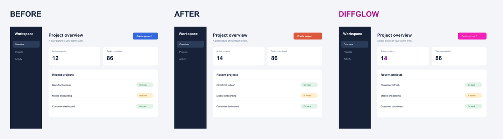

# Diffglow

Compare two screenshots and highlight changes directly over the second image.
Unchanged areas keep their original colors; changed pixels receive a 65% overlay,
magenta by default. You can choose the highlight color. Images stay on your machine.



## Quick start

Requires Node.js 22 or newer. The alpha targets Linux, macOS, and Windows, with CI
coverage configured for Node.js 22 and 24.

```bash
npx --yes diffglow@alpha before.png after.png --output highlighted.png
```

Or install the command:

```bash
npm install --global diffglow@alpha
diffglow before.png after.png --output highlighted.png
```

PNG and JPEG inputs can be mixed. Quote paths containing spaces:

```bash
diffglow "before screenshot.png" "after screenshot.jpg" -o "my diff.png"
```

The command prints the changed-pixel count, changed percentage, and absolute
output path. The default output is `diff.png` in the current directory. Output is
always PNG; missing parent directories are created. An existing result can be
replaced, but neither input can be overwritten, including through a symbolic link
or hard link.

## Integrate with an AI coding agent

The optional [Diffglow skill](./skills/diffglow/SKILL.md) helps your coding agent
integrate visual comparison with existing Playwright, Maestro, or other E2E tests:
**intent → existing E2E captures → evidence → agent feedback → rerun**.

Install Diffglow in your project, then install its bundled skill with the
[Skills CLI](https://github.com/vercel-labs/skills):

```bash
npm install --save-dev --save-exact diffglow@alpha
npx skills add ./node_modules/diffglow/skills/diffglow --skill diffglow
```

Choose your coding agent when prompted. Ask it to "Use the diffglow skill to add
visual verification to my existing E2E tests" or to verify a specific UI change.
The skill includes Playwright and Maestro integration guidance, comparison
commands, and a format for reporting verified effects, defects, and uncertainty.

Your E2E tools still capture screenshots. The skill uses your agent's existing
image-reading capabilities; Diffglow requires no additional AI service or API key.
Pixel statistics, runner assertions, and the agent's visual assessments remain
distinct. Routine changes do not require manual snapshot approvals.

The skill guides the agent; it does not add an AI verification engine, automatic
baseline updates, or a semantic CI gate to the CLI. A completed comparison is not
proof that a UI change is correct. Existing test failures and incomplete coverage
remain visible in the verification report.

## Options

| Option | Behavior |
| --- | --- |
| `-o, --output <path>` | Output `.png` path; defaults to `diff.png`. |
| `--threshold <0..1>` | Per-pixel color tolerance; defaults to `0.1`. Lower is more sensitive. |
| `--highlight-color <hex>` | Overlay color as `#RGB` or `#RRGGBB`; defaults to magenta (`#ff00ff`). |
| `--fail-on-diff` | Exit `1` when changes exist, after saving the highlighted PNG. |
| `--json` | Write detailed comparison statistics as JSON to stdout; still save the PNG. |
| `--manifest <file>` | Compare explicitly named pairs from a JSON manifest. |
| `--config <file>` | Load JSON folder names, matching rules, threshold, and highlight color. |
| `--output-dir <dir>` | Batch/HTML report directory; defaults to `diffglow-report`. |
| `--html` | Generate an offline HTML review page and screenshot assets. |
| `-h, --help` | Show usage. |
| `-v, --version` | Show the installed version. |

For a more sensitive comparison:

```bash
diffglow before.png after.png --threshold 0 --output sensitive.png
```

The threshold controls color differences at individual pixels, rather than an
allowed percentage of changes. Detected anti-aliasing differences are ignored,
including at threshold `0`, to reduce text-edge noise. Diffglow compares visual
pixels rather than file bytes. JPEG compression can introduce visual differences.

Choose a highlight color for a single pair, folders, or manifest comparisons:

```bash
diffglow before.png after.png --highlight-color '#00ff00' -o green-diff.png
diffglow screenshots/ --highlight-color '#0af' --html
```

Quote the hex value so your shell preserves `#`. Colors accept three or six hex
digits, case-insensitively, and are normalized to lowercase `#rrggbb` in JSON.
Opacity stays at 65%. The color affects highlighted pixels, including added and
removed areas, and the HTML report legend; it does not affect which pixels count
as changes or the comparison statistics.

## Compare folders or multiple files

Pass two directories to compare matching relative filenames recursively:

```bash
diffglow baseline/ current/ --output-dir visual-results --fail-on-diff
```

Or pass one folder containing `baseline/` and `current/`:

```text
screenshots/
  baseline/
    home.png
    account/settings.png
  current/
    home.png
    account/settings.png
```

```bash
diffglow screenshots/ --html --output-dir visual-results
```

PNG, `.jpg`, and `.jpeg` filenames are discovered, including uppercase extensions.
Matching is case-sensitive and uses the entire relative filename by default.
Screenshots found only in `current/` are **added**; those found only in `baseline/`
are **removed**. Their entire image area is highlighted. Unrelated file types and
symlinks encountered during directory traversal are ignored. Explicit file inputs
and manifests retain the existing input-alias safeguards.

For arbitrary files, create a manifest. Paths resolve relative to the manifest,
regardless of the directory where you run the CLI:

```json
{
  "pairs": [
    { "id": "home", "before": "approved/home.png", "after": "captures/home.png" },
    { "id": "settings", "before": "older/settings.jpg", "after": "newer/settings.png" }
  ]
}
```

```bash
diffglow --manifest pairs.json --html --output-dir visual-results --json
```

Each pair requires a unique, nonempty `id` and both file paths. An explicitly
listed file that cannot be read is an error, rather than an added/removed entry.
Do not combine `--manifest` with positional inputs, or mix files and directories.
`--output` remains a single-pair PNG option; use `--output-dir` for batches.

### Folder configuration and filename patterns

A single folder input automatically loads its `diffglow.config.json`, if present.
Use `--config path/to/config.json` to select another configuration or apply settings
to explicit files, directories, or a manifest. Relative folder settings resolve
within the single input folder; two explicit directories take precedence over
configured names.
Unknown settings and invalid patterns are rejected before comparisons start.

```json
{
  "baselineDir": "approved",
  "currentDir": "captures",
  "include": ["**/*"],
  "exclude": ["drafts/**", "**/debug-?.png"],
  "baselinePattern": "{key}",
  "currentPattern": "{key}",
  "threshold": 0.1,
  "highlightColor": "#ff00ff"
}
```

Defaults are `baselineDir: "baseline"`, `currentDir: "current"`, and the other
values above with an empty exclusion list. CLI `--threshold` and
`--highlight-color` override their respective config settings.
Explicit manifest pairs are not filtered or renamed by folder matching rules.

Globs use forward slashes: `*` matches within a path segment, `**` matches complete
directory segments, and `?` matches one character. Brace expansion, character
classes, and regular expressions are not supported. Includes/excludes apply to
relative filenames before pairing templates.

For pairs stored in one directory, configure both roots as `.`:

```json
{
  "baselineDir": ".",
  "currentDir": ".",
  "baselinePattern": "{key}.baseline.{ext}",
  "currentPattern": "{key}.current.{ext}"
}
```

This pairs `home.baseline.png` with `home.current.jpg`, and also supports nested
keys such as `account/settings`. Templates contain exactly one `{key}` and at most
one optional `{ext}`. Other template text is literal. `{ext}` matches PNG/JPEG
extensions case-insensitively and is excluded from the identity. Duplicate keys
within either set are errors; for example, two baseline formats for the same key
require more specific naming or an explicit manifest. No matching images is an
input error; an empty baseline with screenshots in current is a valid added batch.

### Batch results and HTML reports

Every batch writes `results.json` and highlighted PNGs. With `--json`, stdout is a
single batch document containing `mode: "batch"`, overall status, artifact paths,
summary counts/pixel totals, per-file results, and the final exit code. Successful
entries reuse the single-pair statistics and include an `id` and relative
`artifacts` paths. Added/removed entries have a null missing input; failed entries
contain an error message and null artifacts. Results are sorted by identity.
The root `rendering` object records the selected highlight color and opacity.

Aggregate changed percentage is the sum of changed pixels divided by the sum of
compared pixels, not the average of individual percentages. Failed entries are
excluded from pixel totals and counted separately. Processing continues after an
individual failure, and exit `2` takes precedence over `--fail-on-diff` exit `1`.

Add `--html` to generate `index.html` with summary counts, search, status filters,
and **Baseline / Current / Highlighted diff** panels. Click an image for full
resolution or expand a comparison for detailed statistics. HTML is opt-in and also
works with a single file pair:

```bash
diffglow before.png after.png -o highlighted.png --html --output-dir review
```

```text
visual-results/
  .diffglow-report
  index.html             # only with --html
  results.json
  assets/
    <comparison-id-hash>/
      baseline.png       # normalized preview; only with --html and a present baseline
      current.png        # normalized preview; only with --html and a present current
      diff.png
```

Open `index.html` directly in a browser. Share or upload the **whole report
directory**, including `assets/`. The page needs no server, network access, or
original screenshot files. Preview images use the normalized pixels actually
compared, with orientation applied. Single-pair JSON stdout keeps its original
shape, including when HTML is requested; a single HTML run's saved `results.json`
uses the run envelope with `mode: "single"`.

Choose a dedicated report directory: it must be new, empty, or marked as
Diffglow-owned. Rerunning replaces that generated directory, removing stale assets
and old HTML when `--html` is omitted. Never put your own files inside it. Reports
are prepared in a separate staging directory before replacement; the report
directory cannot equal or contain inputs, and is excluded from folder discovery.
Comparisons run sequentially to bound memory use. In CI, upload the complete
report directory even when comparison exits with differences or per-file errors.

## Image behavior

- EXIF orientation and color space are normalized to sRGB before comparison.
  Transparency is preserved and compared using pixelmatch's transparency handling.
- Images align at the top-left without resizing. Output dimensions use the larger
  width and height of the two inputs.
- Added and removed areas always count as changes, regardless of threshold.
  Removed content from the first screenshot remains visible under the highlight tint.
- The changed percentage is changed pixels divided by the union of both image
  areas. Parts of the output canvas covered by neither input stay transparent and
  are excluded from that percentage.
- Each decoded input and the combined output canvas are limited to 25 million
  pixels. Animated and multi-page images are rejected.

Diffglow accepts screenshots from websites, mobile browsers, or native mobile
applications as image files. This alpha provides image comparison only; your
existing tools supply the screenshots. It does not capture screens, manage
baselines, or provide a JavaScript library API.

Image processing runs locally, without screenshot uploads or telemetry. npm may
access the network to install the package and its dependencies.

## Machine-readable results

Plain text remains the default. Add `--json` to write a JSON report to stdout
while generating the same highlighted PNG:

```bash
diffglow before.png after.png --output highlighted.png --json > stats.json
```

A comparison with a changed rectangle might report:

```json
{
  "schemaVersion": 1,
  "status": "different",
  "before": { "path": "/workspace/before.png", "width": 100, "height": 100 },
  "after": { "path": "/workspace/after.png", "width": 100, "height": 100 },
  "output": { "path": "/workspace/highlighted.png", "width": 100, "height": 100 },
  "comparison": {
    "threshold": 0.1,
    "includeAntiAliasing": false,
    "alignment": "top-left",
    "dimensionsChanged": false
  },
  "rendering": { "highlightColor": "#ff00ff", "highlightOpacity": 0.65 },
  "stats": {
    "comparedPixels": 10000,
    "changedPixels": 300,
    "unchangedPixels": 9700,
    "changedPercentage": 3,
    "modifiedPixels": 300,
    "addedPixels": 0,
    "removedPixels": 0,
    "diffBounds": { "x": 10, "y": 20, "width": 20, "height": 15 }
  },
  "exitCode": 0
}
```

Paths are absolute and dimensions reflect normalized image orientation.
The additive `rendering` object records the normalized overlay settings in
single-pair and batch reports; the JSON schema version remains `1`.
`modifiedPixels` counts changed pixels within the overlapping image area;
`addedPixels` and `removedPixels` count areas covered by only the corresponding
input. These describe image footprints rather than classifying UI elements.
The three counts sum to `changedPixels`; `comparedPixels` is the union of both
image areas. Bounds use zero-based coordinates from the top-left and enclose all
changed pixels. Identical comparisons have `status: "identical"` and
`diffBounds: null`.

`--fail-on-diff` keeps its usual behavior: write the PNG and JSON report, then
exit `1` when changes exist. With `--json`, errors produce a JSON report on stdout,
leave stderr empty, and exit `2`:

```json
{
  "schemaVersion": 1,
  "status": "error",
  "error": { "message": "Provide exactly two input images. Use --help for usage." },
  "exitCode": 2
}
```

`--help` and `--version` still display plain text when combined with `--json`.

## Exit codes and CI

| Code | Meaning |
| --- | --- |
| `0` | Output written successfully, or help/version displayed. |
| `1` | Changes found with `--fail-on-diff`; the output was still written. |
| `2` | Invalid arguments, unreadable/unsupported image, or processing/output error. |

By default, a successful comparison exits `0` even when changes exist:

```bash
diffglow before.png after.png -o highlighted.png
```

To fail a CI check when changes exist:

```bash
diffglow before.png after.png -o artifacts/diff.png --fail-on-diff
```

In a GitHub Actions job with Node.js installed and both screenshots already
available, add these steps. The artifact upload runs even when differences fail
the comparison:

```yaml
- name: Compare screenshots
  run: npx --yes diffglow@0.1.0-alpha.5 before.png after.png --output artifacts/diff.png --fail-on-diff

- name: Upload highlighted comparison
  if: always()
  uses: actions/upload-artifact@v4
  with:
    name: visual-diff
    path: artifacts/diff.png
    if-no-files-found: warn
```

Pin an exact package version in CI for repeatable runs. Supply a previous or
approved screenshot through your own workflow.

## Examples and contributing

See the [browser screenshot examples](https://github.com/M1chaelChen/diffglow/tree/main/examples/gallery)
for layout shifts, missing images, mobile viewport clipping, and page-size changes.
The mobile example is a browser fixture rather than a device capture.

Development instructions are in [CONTRIBUTING](https://github.com/M1chaelChen/diffglow/blob/main/CONTRIBUTING.md).
Report bugs through [GitHub issues](https://github.com/M1chaelChen/diffglow/issues).
For security concerns, follow the [security policy](https://github.com/M1chaelChen/diffglow/blob/main/SECURITY.md).

Diffglow is licensed under [Apache-2.0](./LICENSE). Third-party dependencies retain
their own licenses; see [THIRD_PARTY_NOTICES](./THIRD_PARTY_NOTICES.md).
